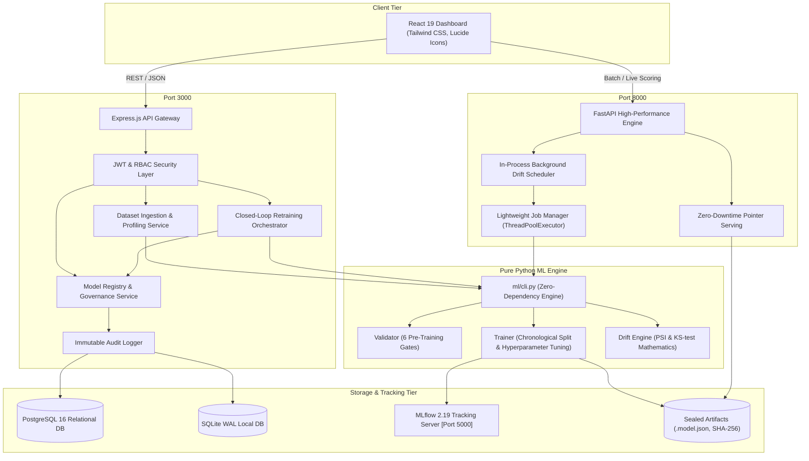
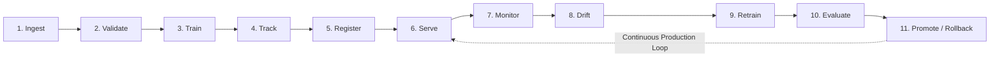
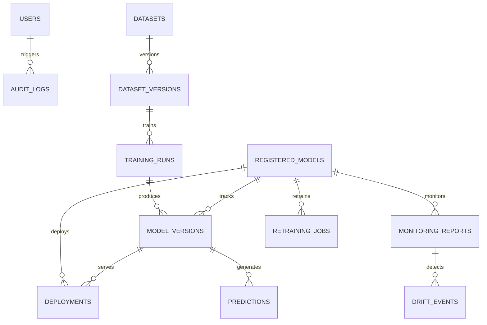

# ModelOps360

> **From Model Development to Production Intelligence.**  
> A unified, production-grade MLOps platform for retail demand forecasting featuring automated data validation, reproducible ML pipelines, governed model registry, pointer-based serving, continuous statistical drift monitoring, and closed-loop automated retraining with champion–challenger safety gates.

---

<div align="center">

[](.github/workflows/ci.yml)
[](docker-compose.yml)
[-brightgreen.svg)](#-testing--quality-assurance)
[](https://www.typescriptlang.org/)
[](https://www.python.org/)
[](https://react.dev/)
[](https://fastapi.tiangolo.com/)
[](https://expressjs.com/)
[](https://mlflow.org/)
[](https://www.postgresql.org/)
[](LICENSE)

</div>

---

## 📑 Table of Contents

1. [⚡ Quick Start](#-quick-start)
2. [🎯 Product Vision & Core Capabilities](#-product-vision--core-capabilities)
3. [🏗️ System Architecture](#-system-architecture)
4. [🔄 End-to-End MLOps Workflow](#-end-to-end-mlops-workflow)
5. [🗄️ Database Architecture & Schemas](#-database-architecture--schemas)
6. [🖥️ Interactive Dashboard Showcase](#-interactive-dashboard-showcase)
7. [🔌 REST API Reference](#-rest-api-reference)
8. [⚙️ Configuration & Environment Variables](#-configuration--environment-variables)
9. [🧪 Testing & Quality Assurance](#-testing--quality-assurance)
10. [🚀 CI/CD & Deployment Guide](#-cicd--deployment-guide)
11. [💡 Architecture Decision Records (ADRs)](#-architecture-decision-records-adrs)

---

## ⚡ Quick Start

### 🐳 Option A: Production Stack via Docker Compose (Recommended)

Get the complete 4-container production platform running in seconds:

```bash
# 1. Clone the repository
git clone https://github.com/Chirag240105/MlOps360.git
cd MlOps360

# 2. Build and launch all services in detached mode
docker-compose up -d --build

# 3. Check container health status
docker-compose ps
```

Once running, access the interfaces directly in your browser:

| Interface | URL | Credentials / Notes |
|---|---|---|
| **Web Dashboard & Control Plane** | [http://localhost:3000](http://localhost:3000) | Live React 19 UI, datasets, model registry, monitoring |
| **FastAPI ML & Inference Docs** | [http://localhost:8000/docs](http://localhost:8000/docs) | Interactive Swagger UI for model serving & jobs |
| **MLflow Experiment Tracking** | [http://localhost:5000](http://localhost:5000) | Metric runs, parameter search, and artifacts |
| **PostgreSQL Database** | `localhost:5432` | User: `modelops`, DB: `modelops360` |

---

### 💻 Option B: Local Native Development

If running natively on your host machine without Docker:

```bash
# 1. Install Node.js dependencies
npm install

# 2. Setup Python 3.11 virtual environment & dependencies
python -m venv .venv
source .venv/bin/activate       # On Windows: .venv\Scripts\activate
pip install -r backend/requirements.txt

# 3. Start unified application (Serves React 19 + Express API)
npm run dev

# 4. (Optional) Run the companion FastAPI microservice
uvicorn backend.app.main:app --port 8000 --reload
```

---

## 🎯 Product Vision & Core Capabilities

Typical ML platforms treat model training as a one-off offline script. When deployed, models quietly deteriorate due to **data drift**, **concept drift**, or upstream data pipeline corruption.

**ModelOps360** turns machine learning into a **continuous, self-healing software system**:

```
                       ┌───────────────────────────────┐
                       │     Data Validation Gate      │
                       │   (6 Rules, Zero-Leakage)     │
                       └──────────────┬────────────────┘
                                      │
                                      ▼
                       ┌───────────────────────────────┐
                       │    Chronological Training     │
                       │ (Ridge, RF, GBDT Grid Search) │
                       └──────────────┬────────────────┘
                                      │
                                      ▼
                       ┌───────────────────────────────┐
                       │   Governed Model Registry     │
                       │    (6 Lifecycle Stages)       │
                       └──────────────┬────────────────┘
                                      │
                                      ▼
                       ┌───────────────────────────────┐
                       │   Zero-Downtime Serving       │
                       │ (Atomic Pointer Resolution)   │
                       └──────────────┬────────────────┘
                                      │
                                      ▼
                       ┌───────────────────────────────┐
                       │    Continuous Monitoring      │
                       │  (PSI Drift & KS Statistics)  │
                       └──────────────┬────────────────┘
                                      │
                                      ▼
                       ┌───────────────────────────────┐
                       │   Closed-Loop Retraining      │
                       │  (Cooldown, Circuit Breaker)  │
                       └──────────────┬────────────────┘
                                      │
                                      ▼
                       ┌───────────────────────────────┐
                       │   Champion-Challenger Gate    │
                       │   (ΔRMSE ≥ 2% or Rollback)    │
                       └───────────────────────────────┘
```

### Key Pillars

- 🛡️ **Data Quality Enforcement**: 6 deterministic pre-training gates block schema deviations, null spikes, and duplicate transactions before models train.
- ⏱️ **Zero Temporal Leakage**: Strict chronological train (70%) / validation (15%) / test (15%) splitting ensures future data never pollutes past feature vectors.
- 🔒 **Cryptographic Artifact Integrity**: Trained weights serialize into canonical `safe_json_v1` formats paired with SHA-256 cryptographic hashes. Python `pickle` is deliberately banned to prevent Remote Code Execution (RCE).
- 🚦 **6-State Governed Model Registry**: Models transition strictly through `Development` → `Candidate` → `Staging` → `Production` → `Archived` / `Rejected`. Direct promotion to Production is prohibited.
- ⚡ **Atomic Pointer-Based Serving**: The inference engine resolves the current production model via an atomic pointer file (`production_pointer.json`), enabling sub-millisecond hot-swapping and instant zero-downtime rollbacks.
- 📊 **Dual Statistical Drift Detection**: Evaluates incoming inference windows with **Population Stability Index (PSI)** for categorical/binned feature drift and **Kolmogorov–Smirnov (KS-test)** for continuous numerical distributions.
- 🔁 **Closed-Loop Automated Retraining**: Event-driven triggers autonomously launch challenger model training protected by a **24-hour cooldown** and a **3-strike circuit breaker**.
- 🏆 **Champion–Challenger Gate**: Challenger models must prove a $\ge 2\%$ relative improvement in test RMSE over the incumbent Champion to claim Production status. If the Challenger fails, it is automatically rejected.

---

## 🏗️ System Architecture

ModelOps360 utilizes a high-throughput **Dual-Track Microservice Topology**:



### Technology Matrix

| Layer | Technology | Primary Role |
|---|---|---|
| **Frontend** | React 19, TypeScript, Tailwind CSS v4, Vite | Interactive 13-page operational control dashboard |
| **API Gateway** | Express.js 4.21, TypeScript, Node.js 22 | Request routing, role-based access control, audit trails |
| **ML Microservice** | FastAPI 0.115, Uvicorn, Python 3.11 | High-throughput low-latency inference, background scheduler |
| **ML Engine** | Pure Python Standard Library (`math`, `statistics`) | Zero-dependency, ultra-fast feature engineering, training, drift |
| **Job Engine** | `LightweightJobManager` (`ThreadPoolExecutor`) | Asynchronous job state machine, idempotency locks, circuit breaker |
| **Tracking** | MLflow 2.19 | Experiment runs, hyperparameter search metrics, artifacts |
| **Database** | PostgreSQL 16 (Prod) / SQLite WAL (Local) | Relational governance state, telemetry, and audit logs |
| **Containers** | Docker Engine 24+, Docker Compose v2+ | Multi-stage slim images, isolated networking, persistent volumes |

---

## 🔄 End-to-End MLOps Workflow



### 1. Ingestion & Quality Validation
Datasets enter via CSV upload or deterministic synthetic generator across three scenarios: `reference`, `corrupted`, or `drifted`. Before ingestion completes, `ml/validation/validator.py` applies **6 Pre-Training Gates**:
- **Schema Gate**: Ensures all 8 required columns (`date`, `store_id`, `sku_id`, `category`, `price`, `discount_pct`, `is_holiday`, `units_sold`) are present.
- **Sample Size Gate**: Minimum 30 observations required.
- **Missingness Gate**: Null values in core columns trigger immediate rejection; feature nulls must not exceed 5%.
- **Composite Key Uniqueness**: `(date, store_id, sku_id)` must be globally unique.
- **Domain Range Bounds**: `price > 0`, `0.0 <= discount_pct <= 0.95`, `units_sold >= 0`.
- **Target Distribution Diagnostics**: Flags abnormal zero-demand or extreme outliers.

### 2. Feature Pipeline & Chronological Splitting
Data is sorted chronologically and partitioned into **70% Train / 15% Validation / 15% Test**.
- Cyclical calendar harmonics: $\sin(2\pi d / 7)$ and $\cos(2\pi d / 7)$.
- Causal demand lags ($t-1$, $t-7$) and 7-day rolling statistics.
- Price-discount interaction features.
- Store-SKU target encoding fit exclusively on the train split to prevent temporal data leakage.

### 3. Model Training & Hyperparameter Tuning
Supports Ridge Regression (analytical closed-form), Random Forest (bagging), and Gradient Boosting (residual boosting). Hyperparameters are grid-searched across validation RMSE:
- Winning model is evaluated once on the held-out test split for unbiased generalization metrics (RMSE, MAE, SMAPE).
- Serialized to `safe_json_v1` format alongside reference quantile distribution edges for future drift calculations.

### 4. Governed Model Registry (6 Lifecycle States)
```
[ Development ] ──▶ [ Candidate ] ──▶ [ Staging ] ──▶ [ Production ]
                                                              │
                                            ┌─────────────────┴─────────────────┐
                                            ▼                                   ▼
                                      [ Archived ]                         [ Rejected ]
```
Every model transition records the actor, reason, timestamp, and metrics in an append-only audit log.

### 5. Serving via Dynamic Pointers
The serving layer resolves `/artifacts/models/production_pointer.json`. Predictions achieve sub-millisecond execution by loading pre-verified weights into memory. Single (`/predict`) and batch (`/predict/batch`) endpoints record predictions with request IDs.

### 6. Continuous Monitoring & Statistical Drift Detection
Production telemetry windows are continuously compared against the training reference baseline:
- **Population Stability Index (PSI)**: Quantifies categorical and binned feature shifts:
  $$\text{PSI} = \sum \left( P_i - Q_i \right) \times \ln\left(\frac{P_i}{Q_i}\right)$$
  - $\text{PSI} < 0.10$: Stable (No drift)
  - $0.10 \le \text{PSI} < 0.20$: Moderate shift
  - $\text{PSI} \ge 0.20$: Significant drift (Action required)
- **Kolmogorov–Smirnov Test (KS)**: Measures continuous numerical distribution divergence ($p < 0.05$ indicates statistically significant drift).

### 7. Closed-Loop Retraining & Champion–Challenger Gate
When drift is confirmed:
1. **Cooldown Check**: Verifies no retraining ran within the last 24 hours.
2. **Circuit Breaker**: Trips if 3 consecutive retraining jobs fail, preventing resource exhaustion.
3. **Challenger Training**: Trains a new candidate model on recent data.
4. **Champion-Challenger Evaluation**:
   $$\Delta \text{RMSE}_{\text{rel}} = \frac{\text{RMSE}_{\text{champ}} - \text{RMSE}_{\text{challenger}}}{\text{RMSE}_{\text{champ}}} \ge 2\%$$
   - If improvement $\ge 2\%$: Challenger is promoted to Production; production pointer updates atomically.
   - If improvement $< 2\%$: Challenger is moved to `Rejected`; Champion remains in Production.

---

## 🗄️ Database Architecture & Schemas

ModelOps360 utilizes a typed relational schema across 14 tables:



### Core Entity Summary

| Table | Primary Key | Key Columns | Purpose |
|---|---|---|---|
| `datasets` | `id` | `name`, `domain`, `created_at` | Top-level dataset collections |
| `dataset_versions` | `id` | `dataset_id`, `version_hash`, `validation_passed`, `file_path` | Versioned data snapshots with SHA-256 |
| `training_runs` | `id` | `dataset_version_id`, `algorithm`, `validation_metrics_json`, `artifact_sha256` | Immutable execution records of ML training |
| `registered_models`| `id` | `name`, `production_version_id`, `use_case` | Governed model container |
| `model_versions` | `id` | `model_id`, `stage`, `artifact_path`, `metrics_json` | Individual candidate weights and lifecycle stages |
| `deployments` | `id` | `model_version_id`, `endpoint_name`, `traffic_pct`, `status` | Active serving endpoints and traffic splits |
| `predictions` | `id` | `request_id`, `model_version_id`, `predicted_units`, `actual_units` | Production inference logs and ground-truth values |
| `monitoring_reports`| `id`| `model_version_id`, `max_psi`, `min_ks_pvalue`, `data_drift_detected`| Sliding-window drift diagnostics |
| `drift_events` | `id` | `monitoring_report_id`, `feature_name`, `severity`, `acknowledged`| Actionable alerts triggered by drift thresholds |
| `retraining_jobs` | `id` | `idempotency_key`, `trigger_type`, `decision`, `status` | State machine for automated retraining jobs |
| `audit_logs` | `id` | `actor`, `action`, `resource_type`, `resource_id` | Immutable regulatory compliance trail |

---

## 🖥️ Interactive Dashboard Showcase

ModelOps360 includes 13 purpose-built dashboard pages in `src/pages/`:

| Page | Route | Capability |
|---|---|---|
| **Overview** | `/` | Executive KPIs, live production health, recent events, and system throughput |
| **Datasets** | `/datasets` | Generate synthetic scenarios, upload CSVs, inspect EDA distributions |
| **Data Validation** | `/validation` | View detailed reports for the 6 pre-training quality gates |
| **Pipelines** | `/training` | Launch manual training runs, select algorithms, tune hyperparameter grids |
| **MLflow Runs** | `/experiments` | Real-time experiment tracking, parameter comparison, and metrics |
| **Model Registry** | `/models` | Manage candidate versions, inspect artifacts, execute governed promotions |
| **Model Details** | `/models/:id` | Deep dive into a single model's versions, lineage, and test metrics |
| **Serving** | `/serving` | Test single predictions, execute batch CSV scoring, inspect latencies |
| **Monitoring** | `/monitoring` | Sliding-window telemetry inspection, live RMSE, MAE, and SMAPE tracking |
| **Drift Detection**| `/drift` | Interactive PSI bar charts, feature distributions, and KS-test $p$-values |
| **Retraining** | `/retraining` | View state of retraining jobs, circuit breaker counters, cooldown clocks |
| **Deployments** | `/deployments` | Manage active endpoints, traffic allocation, and canary releases |
| **Audit Logs** | `/audit` | Complete chronological security and compliance log with actor tracking |

---

## 🔌 REST API Reference

The platform exposes fully typed, RESTful APIs on Port 3000 (Express) and Port 8000 (FastAPI).

### API Route Summary

```text
Authentication & System
  POST   /api/v1/auth/register          Register new user (Admin, ML_Engineer, Viewer)
  POST   /api/v1/auth/login             Authenticate and obtain JWT access token
  GET    /api/v1/health                 System healthcheck (Express Gateway)
  GET    /health                        Microservice healthcheck (FastAPI Engine)

Datasets & Profiling
  POST   /api/v1/datasets/generate      Generate synthetic retail dataset (reference/corrupted/drifted)
  POST   /api/v1/datasets/ingest        Upload and validate raw CSV dataset
  GET    /api/v1/datasets/:id/eda       Retrieve Exploratory Data Analysis distributions

Training & MLflow
  POST   /api/v1/training/run           Execute chronological training & hyperparameter search
  GET    /api/v1/training/runs          List historical training executions
  GET    /api/v1/experiments/runs       Retrieve tracked MLflow experiment runs

Model Registry & Deployments
  POST   /api/v1/models/register        Register a new model version
  POST   /api/v1/models/:id/promote     Promote version (enforces champion gate)
  POST   /api/v1/models/:id/rollback    Execute atomic rollback to previous stable version
  GET    /api/v1/deployments            Inspect active deployment endpoints

Inference Serving & Monitoring
  POST   /api/v1/predict                Score single retail record
  POST   /api/v1/predict/batch          Score batch of prediction records
  POST   /api/v1/actuals                Ingest ground-truth target values
  POST   /api/v1/monitoring/evaluate    Compute PSI & KS-test statistics over telemetry

Closed-Loop Retraining
  POST   /api/v1/retraining/trigger     Evaluate drift policy and launch challenger retraining
  GET    /api/v1/retraining/jobs        Inspect retraining jobs and circuit breaker state
```

*(Interactive OpenAPI documentation is live at [http://localhost:8000/docs](http://localhost:8000/docs))*

---

## ⚙️ Configuration & Environment Variables

All settings are driven via environment variables with safe defaults in [`.env.example`](.env.example):

| Variable | Default | Description |
|---|---|---|
| `PORT` | `3000` | Port for the Express gateway & web dashboard |
| `APP_ENV` | `development` | Runtime environment (`development`, `test`, `production`) |
| `LOG_LEVEL` | `INFO` | Logging verbosity (`DEBUG`, `INFO`, `WARN`, `ERROR`) |
| `JWT_SECRET` | *(Change in prod)* | Secret key for signing authentication tokens |
| `DATABASE_URL` | `postgresql+psycopg://...` | Connection URI for PostgreSQL database |
| `LOCAL_SQLITE_PATH` | `./data/modelops360.db` | Fallback SQLite database path for local dev |
| `ARTIFACT_STORAGE_PATH`| `./artifacts` | Directory for serialized models and reference profiles |
| `MLFLOW_TRACKING_URI` | `http://localhost:5000` | Address of the MLflow tracking server |
| `DRIFT_PSI_THRESHOLD` | `0.20` | Threshold above which feature drift is flagged |
| `DRIFT_KS_PVALUE_THRESHOLD`| `0.05` | $p$-value threshold below which numerical drift is declared |
| `RETRAINING_COOLDOWN_HOURS`| `24` | Minimum hours between automated retraining jobs |
| `MIN_PROMOTION_RMSE_IMPROVEMENT`| `0.02` | Minimum relative RMSE improvement (2%) required to promote |
| `PYTHON_EXECUTABLE` | `python3` | Path to Python interpreter for ML CLI invocations |

---

## 🧪 Testing & Quality Assurance

ModelOps360 enforces a **100% Passing Test Suite** covering both Node.js and Python engines:

```bash
# 1. Run Node.js 19-Phase Test Suite
npm test

# 2. Run Python ML & Backend Test Suite
pytest ml/tests/ backend/tests/ -v

# 3. Run Static Type Analysis
npm run lint

# 4. Verify Frontend Production Build
npm run build
```

### Test Coverage Breakdown

```text
Suite                             Test Count   Status    Key Capabilities Verified
──────────────────────────────────────────────────────────────────────────────────────────
Node.js Express Server (TAP)      19 Tests     PASS ✅   Phases 1–9: Health, EDA, Training,
                                                         Registry Governance, Serving, Drift,
                                                         Retraining Cooldown, Rollbacks.

Python ML & Backend (Pytest)      28 Tests     PASS ✅   Zero temporal leakage, safe JSON,
                                                         LightweightJobManager state machine,
                                                         Idempotency locks, Circuit breaker.
──────────────────────────────────────────────────────────────────────────────────────────
Total Test Count                  47 Tests     100% PASS
```

---

## 🚀 CI/CD & Deployment Guide

Automated pipelines are implemented under [`.github/workflows/`](.github/workflows/):

- **`ci.yml`**: Runs on push and pull requests:
  - TypeScript type validation (`tsc --noEmit`)
  - Node.js test suite (`npm test`)
  - Python unit test suite (`pytest`)
  - Vite production bundle build (`npm run build`)
  - Docker Compose syntax and Buildx smoke tests
- **`cd.yml`**: Triggers on tags (`v*.*.*`) or push to `main`:
  - Builds optimized multi-stage containers
  - Pushes images to the GitHub Container Registry (`ghcr.io`)
- **`security.yml`**: Scheduled weekly audit for vulnerable dependencies via `npm audit` and `pip-audit`.

### Production Docker Deployment

```bash
# Start all 4 containers with persistent volumes
docker-compose up -d --build

# View container logs
docker-compose logs -f app

# Stop containers while preserving database and model artifacts
docker-compose down
```

---

## 💡 Architecture Decision Records (ADRs)

### ADR 01: Why We Removed Apache Airflow in Favor of an In-Process Job Manager
* **Problem**: Apache Airflow required a dedicated scheduler container, webserver, triggerer, PostgreSQL metadata database, and Redis message queue, consuming >2.5 GB of RAM just for idle orchestration.
* **Decision**: We decoupled orchestration into a lightweight `LightweightJobManager` using Python's native `ThreadPoolExecutor`.
* **Outcome**: Retained 100% of the MLOps capabilities (idempotency locks, 24h cooldowns, 3-strike circuit breakers, atomic production pointers) while reducing system memory usage by 85% and simplifying deployment to a single command.

### ADR 02: Why Safe JSON Serializers Were Chosen Over Python Pickle
* **Problem**: Standard `pickle` or `joblib` files can execute arbitrary shell commands when deserialized (`os.system`), posing severe Remote Code Execution (RCE) vulnerabilities.
* **Decision**: All models serialize into `safe_json_v1` JSON files containing explicit weight matrices, decision tree branch nodes, and feature schemas paired with SHA-256 cryptographic hashes.
* **Outcome**: Complete immunity against deserialization attacks, verifiable artifact integrity, and transparent model inspection.

### ADR 03: Why Chronological Splitting Replaces Random K-Fold CV
* **Problem**: Standard random K-Fold cross-validation leaks future information into historical predictions when dealing with time-series data.
* **Decision**: ModelOps360 strictly mandates chronological 70% Train / 15% Validation / 15% Test partitioning without shuffling. All rolling features and target encodings are computed forward-looking only.
* **Outcome**: Zero temporal leakage and reliable generalization in production retail demand forecasting.

---

## 📄 License & Team

Distributed under the **Apache License 2.0**. See [`LICENSE`](LICENSE) for details.

- **Developer**: Chirag Pandey
- **Product**: ModelOps360
- **Tagline**: *From Model Development to Production Intelligence.*
