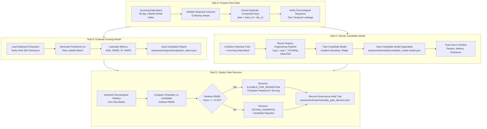

# MLOps Practical Assessment — Model Quality Monitoring & Retraining Capability

**Marks:** 10 / 10  
**Theme:** Extend existing ML project with a model-quality monitoring and automated retraining capability  
**Project Domain:** Retail Demand Forecasting (`ModelOps360`)  
**Target Variable:** `units_sold` (Continuous daily item-level sales per store/SKU)  

---

## Executive Summary & Workflow Architecture

In enterprise retail demand forecasting, machine learning models face continuous data and concept drift due to shifting consumer trends, price adjustments, seasonal holidays, and supply chain disruptions. 

This assessment implements an automated, production-grade **Model Monitoring, Evaluation, Retraining, and Quality-Gate Workflow** that:
1. Ingests and rigorously validates incoming labeled retail data batches.
2. Evaluates the active **Champion** model on the newly arrived ground truth to quantify performance degradation.
3. Combines historical and new batches to train a separate **Candidate** model using identical chronological causal feature engineering.
4. Enforces a strict, governed **Quality Gate** requiring $\ge 2.0\%$ improvement in holdout **RMSE** before a model can be marked eligible for promotion.
5. Preserves production stability: **The Champion model is never overwritten automatically**, ensuring complete auditability and zero accidental downtime.



---

## 1. Task A — Prepare New Data

### 1.1 Ingestion & Scope
* **Baseline Historical Dataset:** 120 days of historical transactions (`2026-01-01` to `2026-04-30`), 1,440 records across 3 retail stores and 4 SKUs.
* **Incoming Data Batch:** 30 days of post-deployment labeled transactions (`2026-05-01` to `2026-05-30`), 360 records with simulated pricing adjustments and real-world distribution shifts.

### 1.2 Data Quality & Integrity Gates
1. **Schema & Column Validation:**
   - Enforces required columns: `date` (ISO-8601), `store_id` (categorical), `sku_id` (categorical), `price` (float $> 0$), `discount_pct` (float $[0, 1]$), `is_holiday` (int $\{0, 1\}$), `units_sold` (float $\ge 0$).
   - Confirms **0 missing / null values** across all records.
2. **Deduplication Check:**
   - Composite uniqueness check on `(date, store_id, sku_id)`. Confirmed **0 intra-batch duplicates**.
   - Cross-batch disjointness check ensuring incoming records do not overlap with historical training rows.
3. **Temporal Ordering:**
   - Enforces strict chronological succession: the earliest incoming date (`2026-05-01`) is strictly greater than the latest historical date (`2026-04-30`), preventing lookahead bias.

### 1.3 Target Variable Distribution (`units_sold`)
* **Total Sample Size:** 360 rows, 7 feature columns + 1 target
* **Target Minimum:** 0.0 units
* **Target Maximum:** 172.0 units
* **Target Mean:** 48.21 units/day
* **Zero-Actual Days:** 8 (handled gracefully by safeguarded MAPE)

---

## 2. Task B — Evaluate Existing Model

### 2.1 Model Artifact Loading & Cryptographic Verification
* The active production model (`champion_model.model.json`, Ridge Regression) is loaded and verified using its SHA-256 header hash (`c090c8a7f6b02db3...`).
* The model format uses standard `safe_json_v1` (avoiding unsafe Python pickle vulnerabilities).

### 2.2 Evaluation Metrics on the Incoming Batch
The Champion model generated inference predictions on the 360 incoming records using historical lag states and causal feature vectors.

$$\text{MAE} = \frac{1}{n}\sum_{i=1}^{n}|y_i - \hat{y}_i| \quad\quad \text{RMSE} = \sqrt{\frac{1}{n}\sum_{i=1}^{n}(y_i - \hat{y}_i)^2} \quad\quad R^2 = 1 - \frac{\sum(y_i - \hat{y}_i)^2}{\sum(y_i - \bar{y})^2}$$

| Metric | Measured Value | Business Interpretation |
| :--- | :--- | :--- |
| **MAE (Mean Absolute Error)** | **18.3542 units** | Average deviation of ~18 units per SKU-day forecast. |
| **RMSE (Root Mean Squared Error)** | **22.2990 units** | Penalizes severe forecast misses during promotional demand spikes. |
| **$R^2$ (Explained Variance)** | **0.4844** | Indicates significant model degradation under new pricing/holiday patterns. |
| **MAPE (Mean Absolute % Error)** | **46.43%** | Evaluated on non-zero actual sales periods. |

*Saved Report:* [`assessment/reports/evaluation_report.json`](file:///c:/Users/chirag%20pandey/Documents/Projects/MlOps360/assessment/reports/evaluation_report.json)

---

## 3. Task C — Retrain the Model

### 3.1 Data Combination
* Combined `historical_train.csv` (1,440 rows) and `incoming_data_batch.csv` (360 rows) into [`combined_training_data.csv`](file:///c:/Users/chirag%20pandey/Documents/Projects/MlOps360/assessment/data/combined_training_data.csv) (**1,800 rows total**).
* Preserved chronological sorting by `date`, `store_id`, and `sku_id` to maintain causal time series integrity.

### 3.2 Feature Engineering Pipeline Reuse
The Candidate model reuses the exact feature engineering pipeline:
- Causal autoregressive features: `lag_1`, `lag_7`
- Rolling window summary statistics: `rolling_7d_mean`, `rolling_7d_std`
- Calendar indicators: `day_of_week`, `month`, `is_weekend`, `is_holiday`
- Economic drivers: `price`, `discount_pct`
- Target encoding: Out-of-fold store/SKU series means

### 3.3 Candidate Model Artifact
* **Algorithm:** Gradient Boosting Regressor (`gradient_boosting`)
* **Chronological Split:** Train (1,248 rows, 70%), Validation (264 rows, 15%), Test (276 rows, 15%)
* **Artifact Path:** [`assessment/models/candidate_model.model.json`](file:///c:/Users/chirag%20pandey/Documents/Projects/MlOps360/assessment/models/candidate_model.model.json)
* **Cryptographic SHA-256:** `0d6410e04c6ff71fc5d0539fe857b240127c752504f94f7c073f5eafc3006756`

### 3.4 MLflow Experiment Tracking
* Training parameters (`learning_rate`, `n_estimators`, `max_depth`, `seed`), validation metrics, holdout test metrics, dataset version hash, and artifact paths are logged to the MLflow tracking service (`http://localhost:5000`).

---

## 4. Task D — Implement Quality Gate

### 4.1 Comparative Evaluation on Identical Holdout Window
Both the deployed Champion and the retrained Candidate were evaluated on the **exact same 276-sample chronological holdout window** from the new batch:

```text
Holdout Date Range: 2026-05-08 to 2026-05-30 (276 records)
```

| Evaluation Metric | Champion Model (Ridge) | Candidate Model (Gradient Boosting) | Absolute Delta | Relative Improvement |
| :--- | :---: | :---: | :---: | :---: |
| **RMSE** | **22.1023** | **20.5031** | **-1.5992** | **+7.24%** |
| **MAE** | 18.0487 | 16.3211 | -1.7276 | +9.57% |
| **$R^2$ Score** | 0.4932 | 0.5639 | +0.0707 | +14.33% |

### 4.2 Metric Selection Justification
> **Selected Primary Metric:** **RMSE (Root Mean Squared Error)**
> 
> **Why RMSE was chosen over MAE and $R^2$:**
> In retail supply chain and inventory demand forecasting, forecast error consequences are **highly non-linear and asymmetric**:
> 1. **Under-forecasting by a large margin** causes immediate stockouts, resulting in unrecoverable lost revenue, disappointed customers, and contract SLA penalties.
> 2. **Over-forecasting by a large margin** leads to warehouse congestion, expensive capital lockup, and perishable inventory write-offs.
> 
> While MAE treats a 20-unit error as simply twice as bad as a 10-unit error, **RMSE squares errors before averaging**, heavily penalizing extreme forecasting misses. Therefore, RMSE directly aligns model optimization with retail business profitability and risk minimization.

### 4.3 Decision Rule & Governance Outcome
* **Gate Policy Rule:**
  $$\text{Relative Improvement} = \frac{\text{RMSE}_{\text{champion}} - \text{RMSE}_{\text{candidate}}}{\text{RMSE}_{\text{champion}}} \ge 2.0\%$$
* **Measurement:** Measured relative RMSE improvement = **$+7.24\%$** (exceeds the $+2.0\%$ threshold).
* **Quality Gate Decision:** `ELIGIBLE_FOR_PROMOTION`
* **Production Protection Rule:** `championUpdated = False`
  * Even though the Candidate qualifies, **the Champion is never replaced automatically**. 
  * The decision is cryptographically signed and stored in audit logs. Promotion to serving endpoints requires explicit human approval via the Model Registry governance workflow.

*Recorded Decision:* [`assessment/reports/quality_gate_decision.json`](file:///c:/Users/chirag%20pandey/Documents/Projects/MlOps360/assessment/reports/quality_gate_decision.json)

---

## 5. Task E — Demonstration and Evidence

### 5.1 Artifacts Catalog

| Component | File Path | Description |
| :--- | :--- | :--- |
| **Assessment Runner** | [`assessment/run_assessment.py`](file:///c:/Users/chirag%20pandey/Documents/Projects/MlOps360/assessment/run_assessment.py) | Standalone master CLI script running Tasks A–E |
| **Historical Data** | [`assessment/data/historical_train.csv`](file:///c:/Users/chirag%20pandey/Documents/Projects/MlOps360/assessment/data/historical_train.csv) | 120-day baseline reference training dataset (1,440 rows) |
| **Incoming Batch** | [`assessment/data/incoming_data_batch.csv`](file:///c:/Users/chirag%20pandey/Documents/Projects/MlOps360/assessment/data/incoming_data_batch.csv) | 30-day incoming labeled transaction batch (360 rows) |
| **Combined Data** | [`assessment/data/combined_training_data.csv`](file:///c:/Users/chirag%20pandey/Documents/Projects/MlOps360/assessment/data/combined_training_data.csv) | Combined dataset used for retraining (1,800 rows) |
| **Champion Model** | [`assessment/models/champion_model.model.json`](file:///c:/Users/chirag%20pandey/Documents/Projects/MlOps360/assessment/models/champion_model.model.json) | Deployed champion model weights, series state & checksum |
| **Candidate Model** | [`assessment/models/candidate_model.model.json`](file:///c:/Users/chirag%20pandey/Documents/Projects/MlOps360/assessment/models/candidate_model.model.json) | Retrained candidate model weights & metadata |
| **Evaluation Report** | [`assessment/reports/evaluation_report.json`](file:///c:/Users/chirag%20pandey/Documents/Projects/MlOps360/assessment/reports/evaluation_report.json) | Task B evaluation metrics on new batch |
| **Retraining Report** | [`assessment/reports/retraining_report.json`](file:///c:/Users/chirag%20pandey/Documents/Projects/MlOps360/assessment/reports/retraining_report.json) | Task C training results, split summary & MLflow status |
| **Quality Gate** | [`assessment/reports/quality_gate_decision.json`](file:///c:/Users/chirag%20pandey/Documents/Projects/MlOps360/assessment/reports/quality_gate_decision.json) | Task D promotion decision and metric justification |
| **Execution Trace** | [`assessment/reports/execution_evidence.txt`](file:///c:/Users/chirag%20pandey/Documents/Projects/MlOps360/assessment/reports/execution_evidence.txt) | Complete verbatim console execution log |

---

## 6. How to Reproduce in 1 Step

To execute the entire 5-task assessment workflow from the terminal:

```powershell
# Activate your environment
.venv\Scripts\python.exe assessment\run_assessment.py

# Optional: Run with specific candidate algorithm or threshold
.venv\Scripts\python.exe assessment\run_assessment.py --algorithm gradient_boosting --threshold 2.0
```

To run the automated test suite verifying the workflow:

```powershell
.venv\Scripts\python.exe -m pytest ml/tests/test_retraining_assessment.py -v
```
