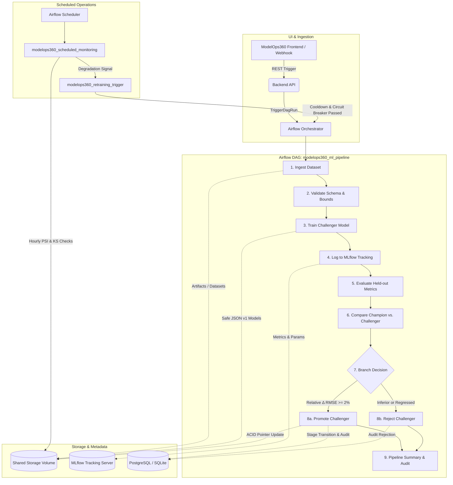

# Apache Airflow Architecture in ModelOps360

## 1. System Overview

ModelOps360 employs **Apache Airflow** as its central, decoupled workflow orchestrator. Rather than embedding business logic within Airflow DAGs, Airflow acts strictly as an orchestration and state coordination layer. It delegates computational workloads to the domain modules (`ml.data`, `ml.validation`, `ml.training`, `ml.monitoring`, and `backend.app.services`).

## 2. Core Architectural Principles

1. **Lightweight XCom Contract (The Golden Rule)**:
   - Large raw datasets, numpy matrices, and trained model weights are **never passed through XCom**.
   - Airflow XCom carries only lightweight primitives: file URIs, UUIDs, checksum digests (SHA-256), and summary metrics.
   - All bulky artifacts reside on shared persistent volumes (`/opt/airflow/artifacts/`).

2. **Idempotent Tasks**:
   - Re-running any task with identical inputs produces the identical outcome without duplicating database rows or generating orphaned files.
   - Datasets are content-addressed using SHA-256 hashes.

3. **Production Safety Gate**:
   - The reigning production champion model is never overwritten unless the challenger demonstrates a statistically significant improvement:
     $$\Delta \text{RMSE} = \frac{\text{RMSE}_{\text{Champion}} - \text{RMSE}_{\text{Challenger}}}{\text{RMSE}_{\text{Champion}}} \ge 2.0\%$$
   - Inferior, corrupted, or regressed models are routed to rejection and quarantined without touching production traffic.

4. **Retraining Guardrails**:
   - Automated triggers are guarded by a 24-hour cooldown period, an active job lock, and a 3-strike circuit breaker to prevent cascading compute waste.
