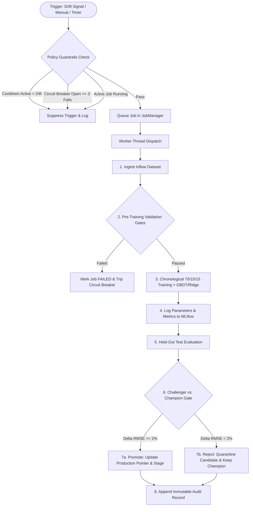

# Automated Closed-Loop Retraining

## 1. Overview

ModelOps360 executes **closed-loop automated retraining**. Retraining is triggered programmatically by drift signals or scheduled checks, validated through domain quality gates, evaluated against production benchmarks, and conditionally promoted—all **without human intervention, yet completely controlled**.

---

## 2. Champion–Challenger Gate Formula

Candidates are never promoted simply because training succeeded. They must beat the reigning champion on the held-out test split:

$$\Delta \text{RMSE} = \frac{\text{RMSE}_{\text{Champion}} - \text{RMSE}_{\text{Challenger}}}{\text{RMSE}_{\text{Champion}}} \ge 2.0\%$$

- **Initial Deployment**: If no production model exists, the first validated model is auto-promoted.
- **Superior Challenger**: Updates `production_pointer.json`, demotes previous model to `Archived`, transitions challenger to `Production`.
- **Inferior / Regressed Candidate**: Quarantined with stage `Rejected`. Production champion remains active.
