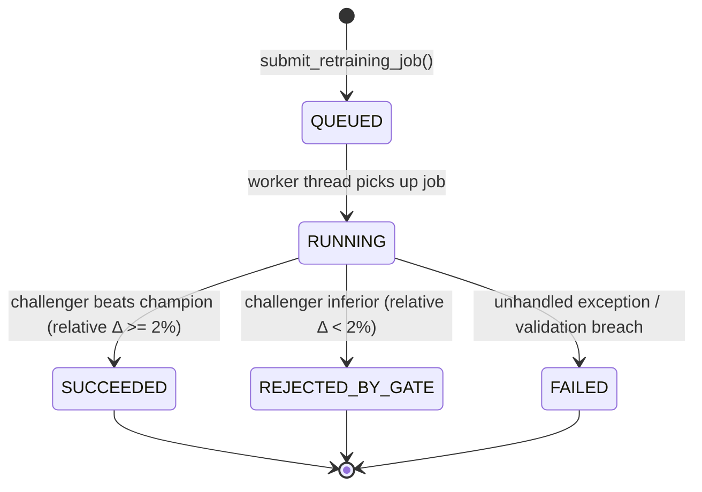

# Lightweight Background Jobs & Task Execution

## 1. Motivation

In MLOps platforms, long-running tasks such as dataset validation, model training, hyperparameter search, and batch drift calculation should **never run directly on HTTP request worker threads**. Doing so causes request timeouts, starves client connections, and creates fragile architectures.

Instead of deploying a massive Celery/Redis/Airflow cluster, ModelOps360 utilizes **`LightweightJobManager`**, an in-process, thread-safe asynchronous job runner.

---

## 2. Job State Machine

Every background job progresses through a deterministic finite-state machine:

### Job States Defined:
- **`QUEUED`**: The job record is created in memory and relational store. Guardrails (cooldown, circuit breaker, active job locks) have passed.
- **`RUNNING`**: Dispatched onto the `ThreadPoolExecutor`. Ingestion, 6-gate validation, chronological splitting, and training are underway.
- **`SUCCEEDED`**: Model training completed, held-out evaluation passed, and the challenger beat the production champion. Production pointer updated.
- **`REJECTED_BY_GATE`**: Training completed, but the candidate did not exceed the required relative improvement threshold ($\Delta \text{RMSE} \ge 2\%$). The reigning champion was preserved.
- **`FAILED`**: Critical error encountered (e.g. data corruption, missing files). Audit log records stack trace.

---

## 3. Production Guardrails

### A. Idempotency Key
External webhooks or retries pass an `idempotency_key` (e.g., `retrain:retail-demand-v1:DRIFT_POLICY:hash`). If an identical key is already registered, the job manager returns the existing job without re-executing training.

### B. Active Job Lock
Only one training or retraining job is permitted per registered model at a time. If an active job is `QUEUED` or `RUNNING`, incoming requests are safely rejected with `ACTIVE_JOB`.

### C. 24-Hour Retraining Cooldown
To prevent model flapping and wasteful compute expenditures, a 24-hour cooldown is enforced following any completed run.

### D. 3-Strike Circuit Breaker
If 3 consecutive retraining jobs end in `FAILED` state, the circuit breaker opens and suppresses automated triggers until manual operator intervention.
