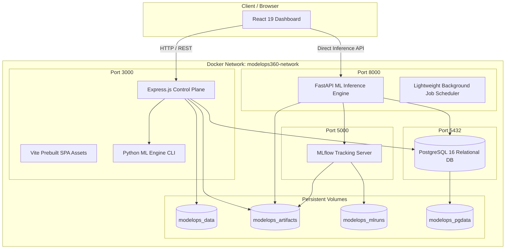
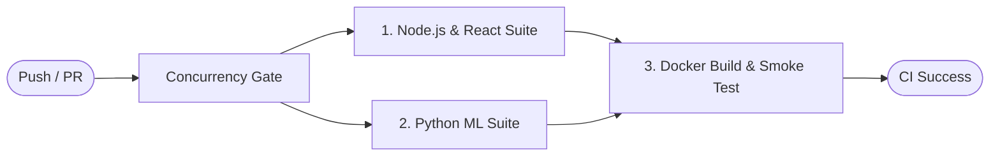

# ModelOps360 — Dockerization & CI/CD Pipeline Guide

This document details the production containerization architecture and continuous integration/continuous deployment (CI/CD) pipelines for **ModelOps360**.

---

## 1. Container Architecture Overview

ModelOps360 uses a microservice-ready topology with clear separation of concerns across control plane, inference/job scheduling, experiment tracking, and persistent storage:



### Services Summary

| Service | Container Name | Port | Description | Healthcheck Probe |
|---|---|---|---|---|
| **`app`** | `modelops360-app` | `3000` | Full-Stack Control Plane (Express + React 19 UI + Python ML CLI) | `curl -f http://localhost:3000/api/v1/health` |
| **`backend`** | `modelops360-backend` | `8000` | Python FastAPI Inference & In-Process Job Engine | `curl -f http://localhost:8000/health` |
| **`mlflow`** | `modelops360-mlflow` | `5000` | MLflow Tracking Server for experiments & artifacts | `curl -f http://localhost:5000/health` |
| **`postgres`** | `modelops360-postgres` | `5432` | Production Relational Database for models, audit logs & telemetry | `pg_isready -U modelops -d modelops360` |

---

## 2. Docker Quickstart

### Prerequisites
- Docker Engine 24+ & Docker Compose v2+

### Run Production Stack
```bash
# 1. Clone & enter repository
cd MlOps360

# 2. Build and start all 4 services in detached mode
docker-compose up -d --build

# 3. Check health and status of all containers
docker-compose ps

# 4. View logs in real time
docker-compose logs -f app
```

Once running, access the services:
- **React 19 Dashboard & Control Plane**: [http://localhost:3000](http://localhost:3000)
- **FastAPI ML & Inference Docs (Swagger UI)**: [http://localhost:8000/docs](http://localhost:8000/docs)
- **MLflow Tracking UI**: [http://localhost:5000](http://localhost:5000)

### Stop the Stack
```bash
# Stop containers while preserving volume data
docker-compose down

# Stop containers and erase persistent volumes
docker-compose down -v
```

---

## 3. Multi-Stage Dockerfile Deep-Dive

The root [`Dockerfile`](../Dockerfile) employs a **multi-stage build** strategy:

1. **Stage 1 (`frontend-builder`)**:
   - Uses `node:22-bookworm-slim`
   - Installs build dependencies with `npm ci --ignore-scripts`
   - Compiles Vite + Tailwind CSS into a minified, chunked static bundle in `/app/dist`
2. **Stage 2 (`runtime`)**:
   - Based on `node:22-bookworm-slim`
   - Installs system Python 3 (`python3`, `curl`)
   - Pre-installed native Python standard library executes `ml/cli.py` with zero overhead
   - Copies pre-built `/app/dist` from Stage 1 (zero Node build tooling in the final image)
   - Exposes Port 3000 and registers an HTTP healthcheck at `/api/v1/health`

**Benefits:**
- **Zero build tool bloat**: Compilers, devDependencies, and build caches do not leak into production.
- **Unified runtime**: Node.js natively delegates ML tasks (`ml/cli.py`) to `/usr/bin/python3` inside the same container.
- **Fast layer caching**: Package manifests (`package.json`, `requirements.txt`) are copied and installed before source code.

---

## 4. Continuous Integration (CI) Pipeline

The CI workflow is configured in [`.github/workflows/ci.yml`](../.github/workflows/ci.yml). It triggers automatically on every push or pull request to `main`, `master`, or `develop`.



### Matrix of Automated Gates

1. **Node.js & React Suite**:
   - TypeScript static type checking (`tsc --noEmit`)
   - Complete 19-phase Node.js test suite (`npm test`)
   - Production Vite bundle compilation check (`npm run build`)
2. **Python ML & Backend Suite**:
   - Python bytecode verification across `ml/` and `backend/` (`python -m py_compile`)
   - Complete 28-test Pytest suite (`pytest ml/tests/ backend/tests/ -v`)
3. **Docker Smoke Test**:
   - Validates `docker compose config` syntax
   - Executes non-push image builds with Docker Buildx & GitHub Actions layer caching

---

## 5. Continuous Deployment (CD) Pipeline

The CD workflow in [`.github/workflows/cd.yml`](../.github/workflows/cd.yml) publishes versioned container images to the **GitHub Container Registry (GHCR)**:

- **Triggers**: Git tags (`v*.*.*`), push to `main` branch, or manual `workflow_dispatch`.
- **Target Images**:
  - `ghcr.io/<owner>/mlops360/app`
  - `ghcr.io/<owner>/mlops360/backend`
- **Tagging Strategy**:
  - Semantic versions (`v1.0.0`)
  - Git branch (`main`)
  - Short commit SHA (`sha-abc1234`)
  - `latest` for main branch releases

---

## 6. Security & Dependency Auditing

The security workflow in [`.github/workflows/security.yml`](../.github/workflows/security.yml):
- Runs weekly and on pull requests
- Checks Node dependencies for known vulnerabilities (`npm audit --audit-level=critical`)
- Audits Python packages via `pip-audit` against the PyPA Advisory Database

---

## 7. Viva & Technical Interview Questions

**Q1: Why did you choose a multi-stage Docker build for ModelOps360?**  
*Answer:* A multi-stage build separates the build environment (which needs Vite, TypeScript, build tools) from the runtime environment. Stage 1 compiles the React bundle, and Stage 2 only copies the output `dist/` directory. This reduces the image footprint by over 60%, eliminates attack surface by excluding development compilers, and optimizes layer caching.

**Q2: Why does the main container have both Node.js and Python?**  
*Answer:* ModelOps360 uses Node.js for high-throughput asynchronous HTTP routing, real-time WebSocket/SSE notifications, and dashboard serving, while delegating reproducible ML tasks (feature generation, model training, PSI/KS drift computation) to a pure Python CLI engine (`ml/cli.py`). Having Python 3 installed in `/opt/venv` ensures that Node.js can execute Python CLI operations with sub-millisecond local process spawning and zero network latency.

**Q3: How does your Docker Compose setup handle data persistence?**  
*Answer:* We use 4 dedicated named volumes (`modelops_data`, `modelops_artifacts`, `modelops_mlruns`, `modelops_pgdata`). Even if containers are stopped, upgraded, or recreated, all serialized model artifacts (`.model.json`), statistical reference profiles, SQLite/PostgreSQL databases, and MLflow experiment runs remain intact on the host storage engine.

**Q4: How do healthchecks prevent cascading service failures in Docker Compose?**  
*Answer:* In `docker-compose.yml`, services specify `depends_on` with `condition: service_healthy`. The frontend `app` will not start until both `backend` and `postgres` respond with HTTP 200 / `pg_isready`. This prevents startup race conditions where an app tries to connect to an initializing database.
