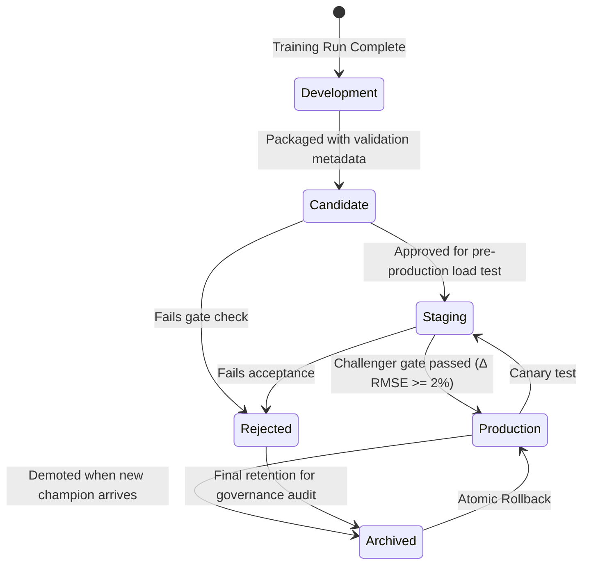

# Model Lifecycle Governance & State Machine

## 1. Governed 6-Stage Finite-State Machine

ModelOps360 enforces a strict finite-state machine governing model stages to eliminate accidental deployments and maintain an unalterable audit trail.

---

## 2. Transition Rules (`ALLOWED_STAGE_TRANSITIONS`)

Transitions are enforced by `validate_stage_transition(current, target)`:

| Current Stage | Allowed Target Stages | Guardrail / Rule |
| :--- | :--- | :--- |
| **`Development`** | `Candidate`, `Rejected`, `Archived` | Models in development cannot transition directly to `Production`. |
| **`Candidate`** | `Staging`, `Rejected`, `Archived` | Must be promoted to `Staging` or evaluated by the Champion-Challenger gate. |
| **`Staging`** | `Production`, `Rejected`, `Archived` | Promotion to `Production` requires passing the $\ge 2\%$ RMSE improvement gate. |
| **`Production`** | `Archived`, `Staging` | When a new model is promoted, the previous champion is transitioned to `Archived`. |
| **`Archived`** | `Production`, `Staging` | Supports **Instant Atomic Rollback** to the most recent stable archived version. |
| **`Rejected`** | `Archived` | Rejected models are quarantined and can never be promoted to `Production`. |

---

## 3. Instant Atomic Rollback

If a newly promoted model displays unforeseen behavior:
1. The rollback engine executes `select_rollback_candidate(versions)`.
2. It prioritizes the **most recent version with stage `Archived`**, falling back to `Staging`.
3. It strictly ignores any versions with stage `Rejected`.
4. It atomically rewrites `production_pointer.json` and updates the registry ledger.
5. Zero downtime: Serving workers resolve the restored model on the next request.
