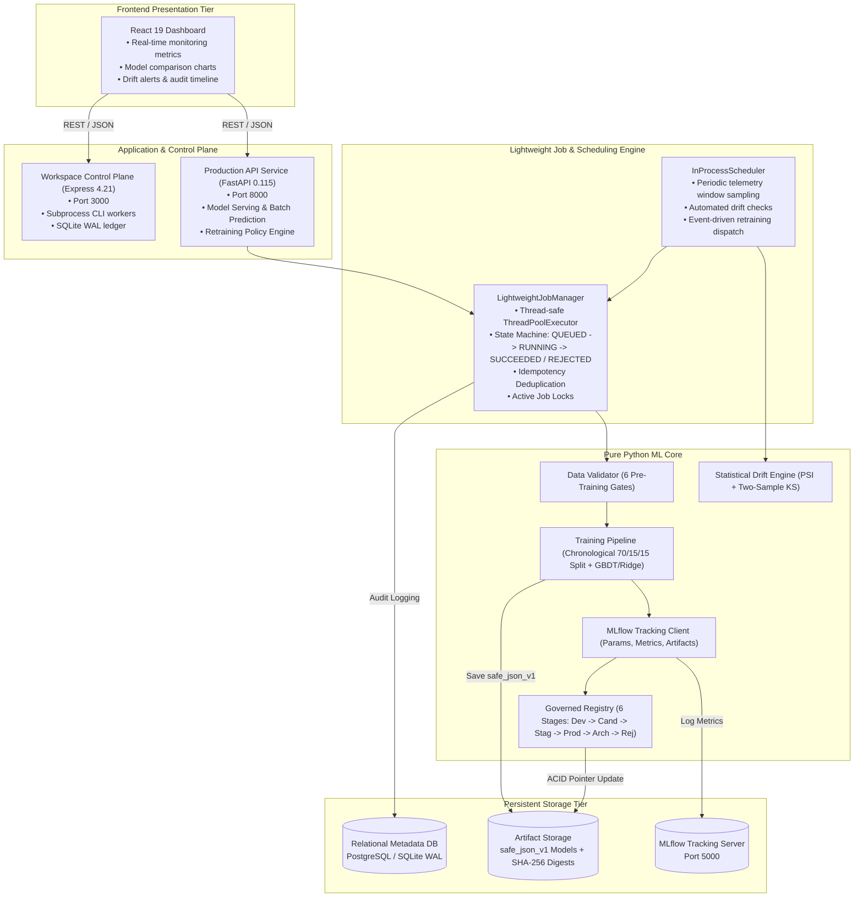

# ModelOps360 Architecture Specification

## 1. System Overview

**ModelOps360** is a lightweight, modular, intelligent MLOps platform for retail demand forecasting. It unifies the entire machine learning lifecycle—from data validation and training to continuous drift monitoring, closed-loop automated retraining, and atomic rollback—**without requiring heavyweight orchestration clusters like Apache Airflow**.

---

## 2. Core Architectural Decisions

### A. Removal of Heavyweight Orchestrators
Previous versions utilized Apache Airflow 2.10. While functional, Airflow required 5 Docker containers, added over 3.5 GB of RAM overhead, lacked native Windows support, and introduced a 30-second scheduling loop. 

ModelOps360 replaced this with `LightweightJobManager` and `InProcessScheduler`:
- **Direct in-process asynchronous dispatch** using standard Python `ThreadPoolExecutor`.
- **Zero latency**: Retraining triggers immediately when drift is detected.
- **Cross-platform**: Runs identically on Windows, Linux, and macOS without containers.

### B. Lightweight XCom Alternative (Filesystem Pointer System)
To avoid storing bulky blobs in relational tables:
- Model artifacts are serialized into canonical `safe_json_v1` JSON files and stored on disk.
- Each model is identified by a SHA-256 digest.
- Active production model is resolved atomically via `production_pointer.json`.

### C. Retraining Guardrail Engine
Automated retraining is protected by three essential guardrails:
1. **Active Job Lock**: Only one job per model can run at any time.
2. **24-hour Cooldown**: Prevents thrashing and redundant compute expenses.
3. **3-strike Circuit Breaker**: Suppresses automated retraining if 3 consecutive runs fail.
