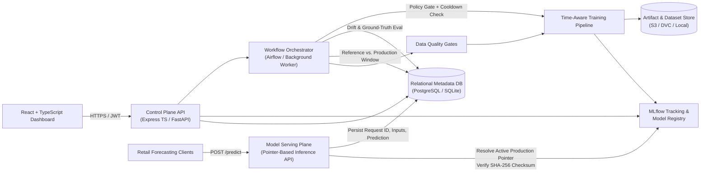

# ModelOps360 System Architecture

## 1. Overall System Architecture (Mermaid Diagram #1)

### Engineering Explanation

1. **Control Plane vs. Serving Plane Isolation:** Governance APIs (dataset uploads, model promotion, rollback, audit queries) never share execution bottlenecks with low-latency `/predict` traffic.
2. **Dynamic Production Pointer:** The serving layer resolves the currently approved `Production` model dynamically from metadata rather than hardcoding an artifact filename.
3. **Traceable Lineage:** Every `model_version` links back to an immutable `dataset_version` checksum, `mlflow_run_id`, training configuration, and Git commit SHA.
4. **Governance Before Promotion:** Registering a model places it in `Development` or `Candidate`. Only validated Challenger-vs-Champion gates or authorized operators promote a model to `Production`.
