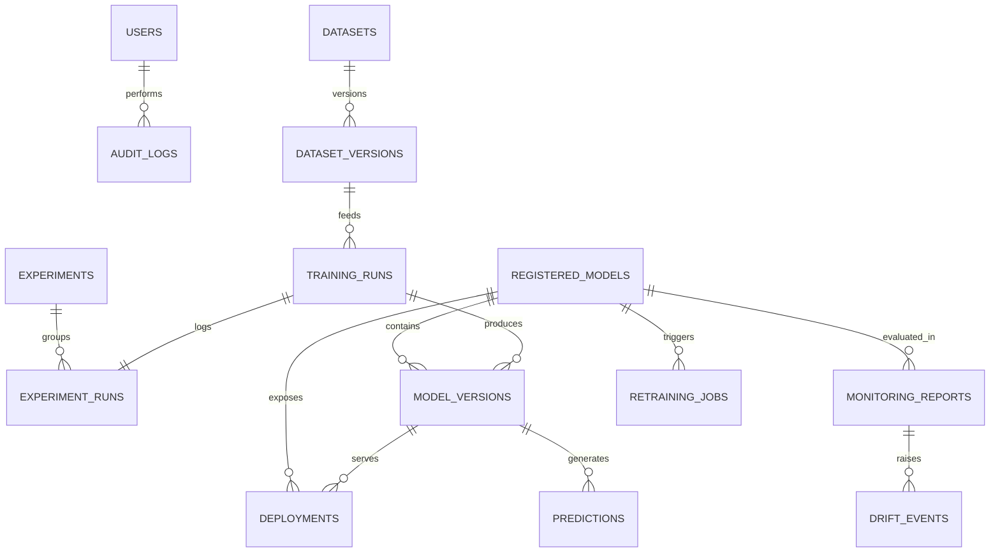

# ModelOps360 Database Design & Data Retention Strategy

## 1. Entity-Relationship (ER) Diagram

## 2. Metadata Separation: PostgreSQL vs. MLflow vs. S3 Object Storage

| Data Category | Storage Layer | Rationale |
| :--- | :--- | :--- |
| Users, RBAC, Datasets, Registry Governance, Deployments, Drift Events, Retraining Jobs, Audit Logs | **PostgreSQL** | Requires ACID transactions, foreign-key integrity, unique idempotency keys, and fast indexed API queries. |
| Experiment hyperparams, metric step series, MLflow run UUIDs | **MLflow Tracking Server (PostgreSQL Backend)** | Purpose-built experiment comparison; app DB links via `mlflow_run_id` rather than duplicating step telemetry. |
| Raw CSV datasets, `.model.json` / XGBoost artifacts, Evidently HTML reports | **Amazon S3 / Local Volume + DVC** | Large immutable blobs are expensive in relational DBs; DB stores URI + `SHA-256` checksum. |

## 3. Indexing & Constraint Strategy
- **Composite Time-Window Indexes:** `idx_predictions_model_created(model_id, created_at DESC)` and `idx_monitoring_reports_model_created(model_id, created_at DESC)` prevent full table scans during sliding-window drift evaluation.
- **Idempotency Uniqueness:** `retraining_jobs.idempotency_key` has a `UNIQUE` constraint so duplicate alerts or Airflow retries cannot spawn duplicate training jobs.
- **Lifecycle Integrity:** `CHECK (stage IN ('Development','Candidate','Staging','Production','Archived','Rejected'))` prevents arbitrary stage strings at the database layer.

## 4. Data Retention Policy
- **Predictions (`predictions`):** Hot retention for **90 days** in PostgreSQL; older rows exported nightly to partitioned S3 Parquet (`s3://.../predictions/year=YYYY/month=MM/`) for long-term backtesting.
- **Model Artifacts & Dataset Versions:** Immutable retention while referenced by any `Production` or `Archived` rollback candidate (minimum 180 days).
- **Audit Logs (`audit_logs`):** Append-only, immutable retention (**7 years** compliance window).
