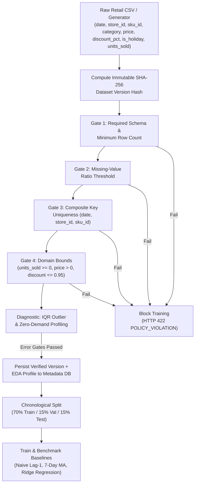
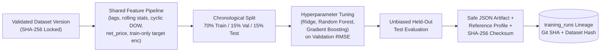

# ModelOps360 ML Pipeline & Data Validation

## 1. Data Ingestion & Pre-Training Validation Pipeline (Mermaid Diagram #2)

## 2. Why Chronological Splitting Is Mandatory

Retail demand is autocorrelated over time and exhibits calendar seasonality (weekends, paydays, holidays). Randomly shuffling rows (`train_test_split(..., shuffle=True)`) places Tuesday's sales in the test set while Wednesday's and Monday's sales of the *same week* sit in training—causing **temporal leakage**.

In `ml/training/baselines.py`:
1. Records are sorted strictly by `(date, store_id, sku_id)`.
2. Lag features (`lag_1`, `rolling_7d_mean`) are computed strictly causally from $t - 1 \dots t - 7$.
3. Store-SKU target encoding (`store_sku_train_mean`) is fit **only** on the training split and mapped to validation/test.
4. `max(train.date) < min(val.date) <= max(val.date) < min(test.date)` is asserted in automated tests.

## 3. Safeguarded MAPE

Standard $\text{MAPE} = \frac{100}{n}\sum \frac{|y - \hat{y}|}{|y|}$ fails with division-by-zero whenever a SKU experiences a zero-sales stockout day ($y = 0$). Our `ml/training/metrics.py` computes:
- `MAE` and `RMSE` across all samples.
- Safeguarded `mapePct` computed strictly over samples where $|y| \ge 1.0$, alongside explicit `zeroActualCount`.
- `smapePct` (Symmetric MAPE), which remains bounded $[0\%, 200\%]$ even when $y = 0$.

---

## 4. Reproducible ML Training Workflow (Mermaid Diagram #3)

### Feature Engineering Catalog (`ml/features/pipeline.py`)
* **Pricing & Promo Signals:** `price`, `discount_pct`, `net_price = price * (1 - discount_pct)`, `price_discount_interaction = price * discount_pct`
* **Calendar Cyclicity:** `is_holiday`, `is_weekend`, `dow_sin = sin(2*pi*dow/7)`, `dow_cos = cos(2*pi*dow/7)`
* **Causal Demand History:** `lag_1`, `lag_7`, `rolling_7d_mean`, `rolling_7d_std`
* **Series Baseline:** `store_sku_train_mean` (fit strictly on `train_rows`)

### Safe Serialization vs. `pickle`
Python `pickle.loads()` executes arbitrary `__reduce__` opcodes and is an RCE vector if an attacker compromises artifact storage. ModelOps360 serializes trees and linear weights as canonical `safe_json_v1` JSON (or XGBoost `.json`/`.ubj` in Track B) and verifies the `SHA-256` checksum before loading.

