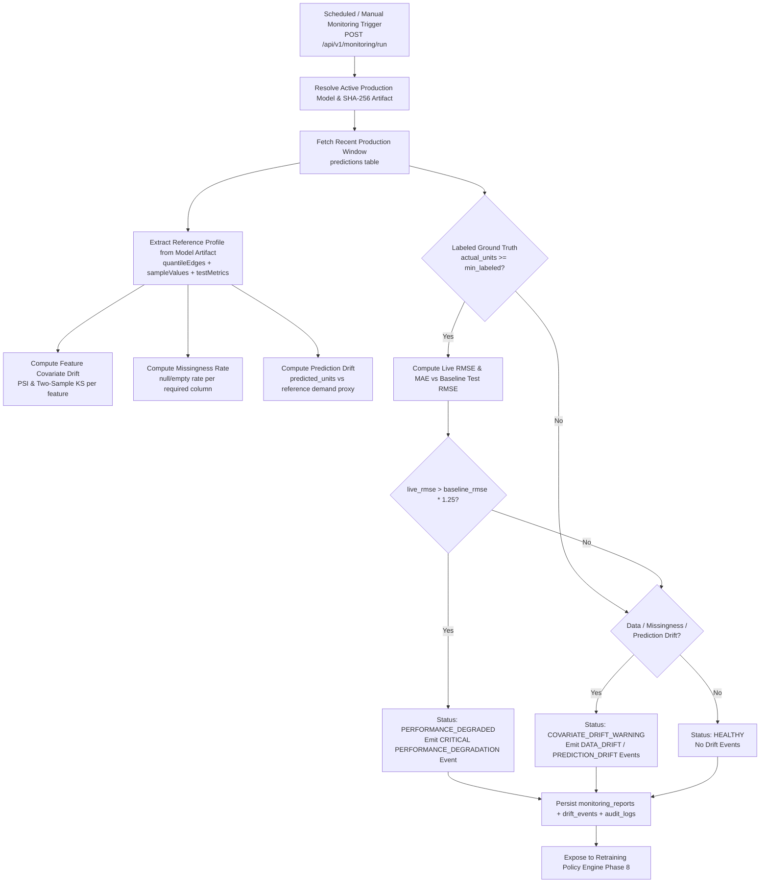

# ModelOps360 — Drift & Performance Monitoring Architecture (Phase 7)

## 1. Drift Detection Workflow (Mermaid Diagram #6)

---

## 2. Four Distinct Failure Modes (Why Monitoring Separates Them)

| Signal | Formal Definition | Observable Immediately? | Meaning in Retail Forecasting | Automated Response |
| :--- | :--- | :--- | :--- | :--- |
| **Data (Covariate) Drift** | $P_{\text{prod}}(X) \neq P_{\text{train}}(X)$ | Yes (input features logged at `/predict`) | Store runs unusually deep discounts (`45%`) or raises prices (`$7.50+`) | Raise `COVARIATE_DRIFT_WARNING`; investigate before retraining |
| **Missingness Drift** | Upstream null/zero-fill rate spike | Yes (request payload inspection) | POS feed or ETL upstream stops sending `discount_pct` or `price` | Fix data pipeline; do **not** retrain on broken ETL! |
| **Prediction Drift** | $P_{\text{prod}}(\hat{y}) \neq P_{\text{train}}(\hat{y})$ | Yes (model outputs) | Forecasts shift strongly upward/downward relative to reference period | Corroborate with covariate drift or seasonality calendar |
| **Concept Drift / Performance Degradation** | $P_{\text{prod}}(y \mid X) \neq P_{\text{train}}(y \mid X)$ and $\text{RMSE}_{\text{live}} > 1.25 \cdot \text{RMSE}_{\text{test}}$ | Delayed (requires `actual_units` reconciliation) | Customer price elasticity or store behavior changed; model accuracy is genuinely broken | Raise `CRITICAL` `PERFORMANCE_DEGRADATION`; eligible for Challenger retraining |

---

## 3. Statistical Detectors Explained

### Population Stability Index (PSI)
$$\text{PSI} = \sum_{b=1}^{B} \left(q_b - p_b\right) \ln\left(\frac{q_b}{p_b}\right)$$
where $p_b$ is the proportion of training-reference samples falling into quantile bin $b$ (stored inside the signed model artifact's `referenceProfile`), and $q_b$ is the proportion of current production samples in bin $b$ (smoothed with $\epsilon = 10^{-4}$ to prevent $\ln(0)$).
- $\text{PSI} < 0.10$: Stable distribution
- $0.10 \le \text{PSI} < 0.20$: Moderate shift (watch)
- $\text{PSI} \ge 0.20$: Significant drift alert

### Two-Sample Kolmogorov-Smirnov (KS) Test
Measures the maximum vertical distance between the empirical CDFs of the training reference sample $F_{\text{ref}}(x)$ and production window $F_{\text{prod}}(x)$:
$$D = \sup_x \left| F_{\text{ref}}(x) - F_{\text{prod}}(x) \right|$$
- **Production Trap (Sample-Size Sensitivity):** When $N$ is very large ($10{,}000+$ rows), KS can report $p < 0.001$ for a tiny $\$0.02$ price fluctuation that has zero business impact. ModelOps360 guards against alert fatigue by requiring **either** $\text{PSI} \ge 0.20$ **or** both statistical significance ($p < 0.05$) AND meaningful effect size ($\text{PSI} \ge 0.10$).

---

## 4. API Endpoints (Phase 7)
- `POST /api/v1/monitoring/run` — Execute statistical drift & live performance analysis on recent production predictions.
- `GET /api/v1/monitoring/reports` — List persisted monitoring reports (`?modelId=...`).
- `GET /api/v1/monitoring/drift-events` — List granular feature/prediction/performance alerts (`?modelId=...&acknowledged=false`).
- `POST /api/v1/monitoring/drift-events/:eventId/acknowledge` — Mark an alert acknowledged with an immutable audit entry.
