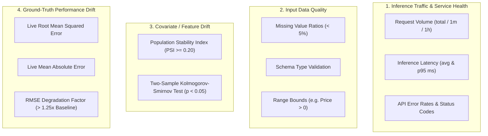

# Continuous Production Monitoring

## 1. Overview

Production machine learning models operate in dynamic real-world environments. Changes in consumer preferences, supplier pricing, economic conditions, or upstream data pipelines cause **model decay**.

ModelOps360 provides continuous, automated production monitoring without requiring external infrastructure like Airflow or Datadog.

---

## 2. Monitored Metrics

ModelOps360 tracks four distinct operational categories:

---

## 3. Storage and Telemetry Flow

1. **Prediction Logging**: Every call to `POST /predict` records:
   - Unique `request_id`
   - Active `model_version_id`
   - Monitored feature values
   - Predicted units and latency
2. **Ground-Truth Label Joining**: When actual sales data arrives, records are joined on `(store_id, sku_id, date)`.
3. **Audit Ledger**: Monitoring reports are saved as JSON artifacts in `artifacts/monitoring/{report_id}.json` and indexed in the `monitoring_reports` table.
