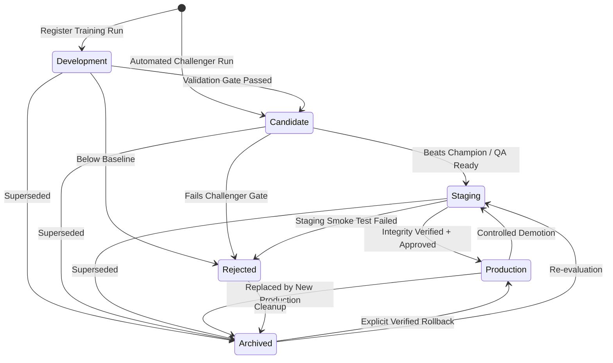
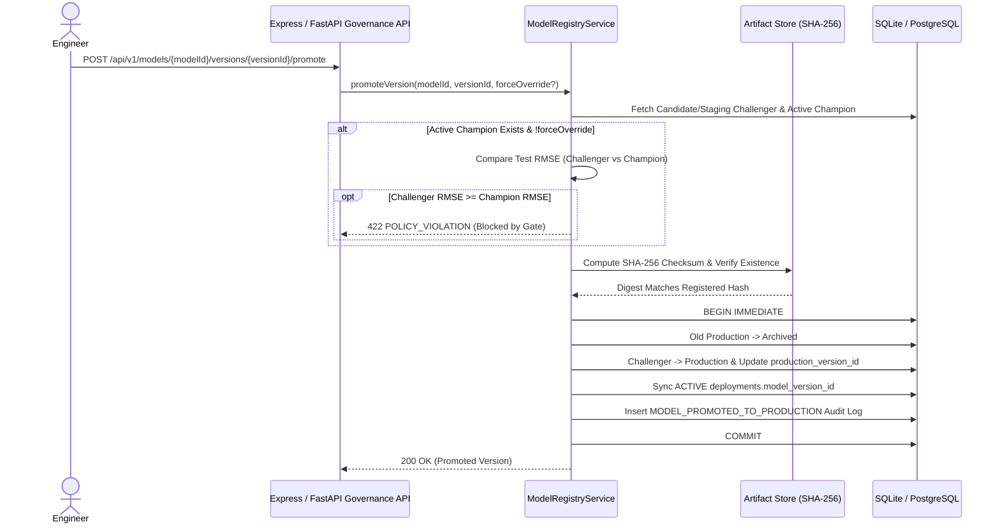
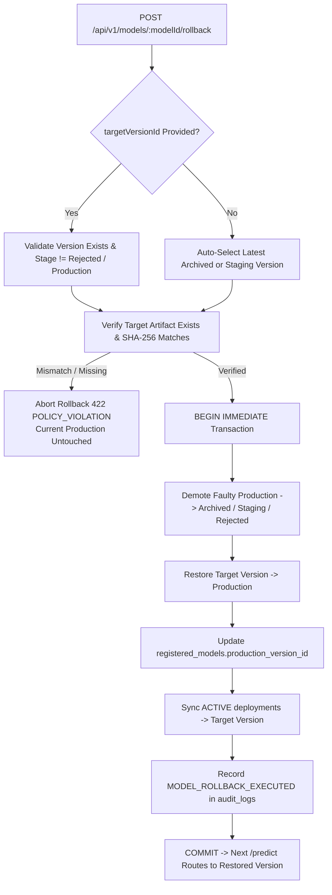

# Experiment Tracking & Model Registry Governance

## 1. Model Lifecycle State Machine (Mermaid Diagram #4)

---

## 2. How MLflow Works Internally

When ModelOps360 runs in full containerized Python mode (`backend/app/ml/mlflow_tracker.py`), MLflow splits storage into **two distinct stores**:

1. **Backend Store (PostgreSQL):** Stores structured relational telemetry—experiment IDs, run UUIDs, parameters, metric histories, run tags, registered model names, version numbers, and aliases (`@production`, `@staging`).
2. **Artifact Store (S3 or Local Volume):** Stores large binary/JSON artifacts (`model.json`, feature profiles, Evidently drift reports) under `s3://<bucket>/mlflow/<experiment_id>/<run_id>/artifacts/`.

### Why Wrap MLflow With Application-Level PostgreSQL Governance?
- MLflow tracks *experimental lineage*, while ModelOps360's PostgreSQL registry enforces **ACID transactional state locks**, **SHA-256 tamper verification** prior to promotion, **RBAC actors**, and **immutable `audit_logs`** tied to deployments and retraining policies.
- Registering a model version places it in `Development` or `Candidate`—never `Production`.

---

## 3. Model Promotion Workflow (Mermaid Diagram #8)

---

## 4. Controlled Rollback Workflow (Mermaid Diagram #9)

