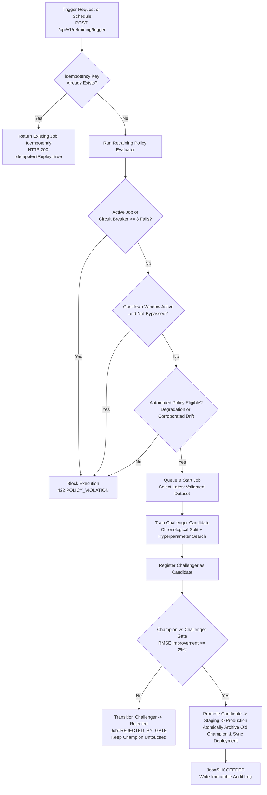

# ModelOps360 — Automated Retraining Engine & Guardrails (Phase 8)

## 1. Automated Retraining Workflow (Mermaid Diagram #7)

---

## 2. Production Guardrails Implemented

| Guardrail | Mechanism | Why It Matters in Production |
| :--- | :--- | :--- |
| **Idempotency Keys** | `UNIQUE(idempotency_key)` on `retraining_jobs` | Prevents duplicate GPU/CPU training runs when Airflow tasks retry or webhooks fire twice |
| **Cooldown Window** | `RETRAINING_COOLDOWN_HOURS` (default `24h`) | Prevents "retraining storms" on oscillating traffic; operators must pass `bypassCooldown: true` for emergency runs |
| **Circuit Breaker** | Trips at `3` consecutive `FAILED` runs | Stops infinite retry loops against corrupted upstream feeds or broken code |
| **Policy Eligibility** | Requires proven `PERFORMANCE_POLICY` or corroborated severe `DRIFT_POLICY` | Never wastes compute retraining on benign single-feature noise |
| **Champion vs Challenger Gate** | Enforces `MIN_PROMOTION_RMSE_IMPROVEMENT` (`>= 2%`) before promotion | Never promotes a new model just because retraining ran; inferior challengers are marked `Rejected` while Champion stays live |

---

## 3. API Endpoints (Phase 8)
- `POST /api/v1/retraining/evaluate` — Evaluate policy eligibility, cooldown status, and circuit breaker without starting a job.
- `POST /api/v1/retraining/trigger` — Idempotently trigger Challenger training and run the Champion vs Challenger promotion gate.
- `GET /api/v1/retraining/jobs` — List historical retraining jobs and decisions (`?modelId=...`).
- `GET /api/v1/retraining/jobs/:jobId` — Inspect a specific retraining run.
