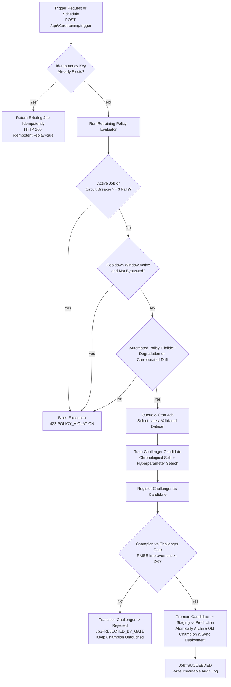

# ModelOps360 — Automated Retraining Engine & Guardrails (Phase 8)

## Practical assessment: labeled-batch evaluation and retraining

The assessment command evaluates a checksum-verified champion on a new labeled
batch, validates both datasets, retrains a separate candidate on their combined
rows, and saves an auditable promotion decision. It does **not** change the
production pointer.

Run these commands from the repository root in PowerShell (Python 3.11+):

```powershell
python -m ml.cli generate-dataset --days 120 --start-date 2026-01-01 --scenario reference --output artifacts\assessment\historical.csv
python -m ml.cli generate-dataset --days 30 --start-date 2026-05-01 --scenario drifted --seed 43 --output artifacts\assessment\incoming.csv
python -m ml.cli train-pipeline --input artifacts\assessment\historical.csv --artifact-dir artifacts\assessment\champion --run-id assessment_champion --algorithm ridge
```

Copy the `artifactSha256` from the training command into the next command:

```powershell
python -m ml.cli retraining-assessment --historical artifacts\assessment\historical.csv --new-data artifacts\assessment\incoming.csv --champion-artifact artifacts\assessment\champion\assessment_champion.model.json --champion-sha256 <SHA256_FROM_TRAINING> --artifact-dir artifacts\assessment\candidate --run-id assessment_candidate
```

The generated incoming CSV is a later-dated synthetic retail batch with a
simulated pricing and promotion shift; it can be replaced by any CSV matching
the project's retail schema. The command checks required columns, missing
values, domain rules, duplicate date/store/SKU keys, and chronological ordering.
The JSON report includes the incoming row count and target summary, champion
metrics for the full batch, and champion/candidate metrics on the same
chronological holdout from the new batch. It also records the validation
results, candidate artifact path and checksum, MLflow tracking status, and
quality-gate decision.

Promotion eligibility requires at least a 2% reduction in holdout RMSE, matching
the existing project policy. RMSE is used because it is already the model
promotion metric and penalizes large unit-forecast errors. A passing candidate
is only marked `ELIGIBLE_FOR_PROMOTION`; the champion is never replaced by this
assessment command. When MLflow is installed, the candidate run and artifact
are logged to `MLFLOW_TRACKING_URI`; otherwise the report records that tracking
was unavailable.

The report is saved as `assessment_report.json` in the output directory, and
the candidate model is saved there separately. These artifacts are ignored by
Git through the existing `artifacts/` ignore rule.

## 1. Automated Retraining Workflow (Mermaid Diagram #7)



---

## 2. Production Guardrails Implemented

| Guardrail | Mechanism | Why It Matters in Production |
| :--- | :--- | :--- |
| **Idempotency Keys** | `UNIQUE(idempotency_key)` on `retraining_jobs` | Prevents duplicate GPU/CPU training runs when Airflow tasks retry or webhooks fire twice |
| **Cooldown Window** | `RETRAINING_COOLDOWN_HOURS` (default `24h`) | Prevents "retraining storms" on oscillating traffic; operators must pass `bypassCooldown: true` for emergency runs |
| **Circuit Breaker** | Trips at `3` consecutive `FAILED` runs | Stops infinite retry loops against corrupted upstream feeds or broken code |
| **Policy Eligibility** | Requires proven `PERFORMANCE_POLICY` or corroborated severe `DRIFT_POLICY` | Never wastes compute retraining on benign single-feature noise |
| **Champion vs Challenger Gate** | Enforces `MIN_PROMOTION_RMSE_IMPROVEMENT` (`>= 2%`) before promotion | Never promotes a new model just because retraining ran; inferior challengers are marked `Rejected` while Champion stays live |

---

## 3. API Endpoints (Phase 8)
- `POST /api/v1/retraining/evaluate` — Evaluate policy eligibility, cooldown status, and circuit breaker without starting a job.
- `POST /api/v1/retraining/trigger` — Idempotently trigger Challenger training and run the Champion vs Challenger promotion gate.
- `GET /api/v1/retraining/jobs` — List historical retraining jobs and decisions (`?modelId=...`).
- `GET /api/v1/retraining/jobs/:jobId` — Inspect a specific retraining run.
