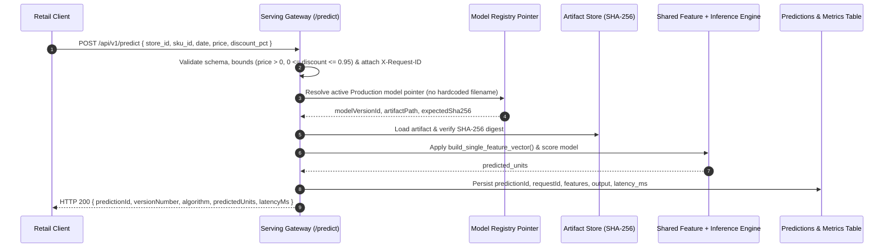

# Model Serving & Prediction Logging

## 1. Prediction Request Lifecycle (Mermaid Diagram #5)

## 2. Delayed Ground-Truth Reconciliation
Retail sales actuals (`units_sold`) arrive at end-of-day or end-of-week—long after `/predict` responded. `POST /api/v1/predictions/ground-truth` joins actual sales back to logged `predictions` rows by `predictionId` or `(date, store_id, sku_id)` so Phase 7 monitoring can calculate true live `MAE` and `RMSE`.
